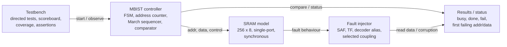

# FaultScope

**An Open-Source SRAM MBIST and Fault-Injection Verification Framework**

FaultScope is a small, fully open-source project that designs a **Memory Built-In Self-Test (MBIST) controller** using the **March C−** algorithm and verifies it with a **fault-injection environment**. A separate verification wrapper injects controlled memory faults, and a Python flow reports which fault behaviours are detected and which are not.

| | |
|---|---|
| **Target memory** | 256 × 8 behavioural, single-port, synchronous SRAM (parameterized) |
| **Algorithm** | March C− (10N operations) |
| **Languages** | SystemVerilog (RTL + testbench), Python 3 (campaign runner + reporting) |
| **Tools** | Verilator, GTKWave, Yosys, SymbiYosys (optional), Git |
| **Planned effort** | ~35 focused hours |
| **Cost** | No paid EDA tools required |

> **Project status:** Planning / specification stage. The roadmap below tracks progress; tick the milestones as they are completed.

---

## Table of Contents

1. [Purpose](#purpose)
2. [Why this project matters](#why-this-project-matters)
3. [Architecture](#architecture)
4. [March C− algorithm](#march-c-algorithm)
5. [Fault models](#fault-models)
6. [Repository structure](#repository-structure)
7. [Tools](#tools)
8. [Getting started](#getting-started)
9. [Verification plan](#verification-plan)
10. [Metrics reported](#metrics-reported)
11. [Roadmap](#roadmap)
12. [Limitations and scope](#limitations-and-scope)
13. [Stretch goals](#stretch-goals)
14. [References](#references)
15. [License](#license)

---

## Purpose

Design a small memory subsystem that **tests its own contents** using a March algorithm, while a separate verification environment **injects controlled faults** and **measures which fault behaviours are detected**.

### Expected outcomes

- A synthesizable MBIST controller RTL block with `start`, `busy`, `done` and `fail`/status signals.
- A parameterized single-port SRAM behavioural model (initial target: 256 words × 8 bits).
- A March C− sequencer with correct ascending and descending address traversal.
- Verification-only fault models: stuck-at, transition, address-decoder aliasing, and carefully defined coupling behaviours.
- A self-checking testbench with a reference model, assertions, functional coverage and regression tests.
- A machine-readable fault campaign report (injected faults, detected/undetected outcomes, first-failure information).
- A documented statement of the exact fault subtypes tested and the limitations of the behavioural model.

### Success criteria

- The **clean SRAM must pass** the complete test.
- Each injected fault must produce a result **consistent with the specified fault model** and the algorithm's expected coverage.
- The report must **distinguish detected from undetected faults**. A fault subtype is not assumed to be detected just because it belongs to a broad category.

---

## Why this project matters

SRAM macros are used throughout SoCs as caches, register files and buffers. A memory can fail even when the surrounding logic is correct: manufacturing defects or reliability effects can leave a bit stuck, prevent it from changing state, make an address respond incorrectly, or disturb a neighbouring cell. Testing every cell through the normal processor/software path is slow and hard to control.

MBIST adds on-chip test logic that applies known write/read sequences and compares observed data with expected values, as part of the broader design-for-test (DFT) flow. March tests are attractive because they apply systematic operations over all addresses, with test time linear in the number of cells.

FaultScope demonstrates the intersection of **RTL design, DFT concepts, fault modelling and verification**, and produces measurable evidence: test length, detection results per fault subtype, first failing address, detection latency and coverage.

---

## Architecture



**Key design decision:** the fault injector lives in the **verification model/wrapper only**. It is *not* part of the synthesizable MBIST datapath. This keeps the design-under-test clean and makes fault campaigns reproducible.

### Components

- **MBIST datapath/control** – an FSM sequences the six March elements; an address counter generates the current address and traversal direction; a data-pattern/control block selects written and expected values; a comparator checks SRAM read data; status registers capture completion and failure information.
- **Memory access mux** – in a real integration, functional logic and MBIST share the SRAM port via a mux. The MVP implements the MBIST-to-SRAM path only; the mux is a stretch goal.
- **Fault injector** – alters memory behaviour according to a selected fault configuration (verification-only).

---

## March C− algorithm

For an N-word memory, March C− applies **10N** elementary operations:

| Element | Order | Operations | Description |
|---|---|---|---|
| M0 | ⇕ | `(w0)` | Initialize all cells to 0 |
| M1 | ⇑ | `(r0, w1)` | Ascending: read 0, then write 1 |
| M2 | ⇑ | `(r1, w0)` | Ascending: read 1, then write 0 |
| M3 | ⇓ | `(r0, w1)` | Descending: read 0, then write 1 |
| M4 | ⇓ | `(r1, w0)` | Descending: read 1, then write 0 |
| M5 | ⇕ | `(r0)` | Read 0 across all addresses |

**Notation:** ⇑ ascending addresses · ⇓ descending addresses · ⇕ either order · `rX` read expecting X · `wX` write X.

For N = 256, the expected total is **2,560 memory operations**.

---

## Fault models

A fault model is an **abstraction** of faulty behaviour, not a physical defect simulator. FaultScope implements **one deterministic subtype at a time** and documents its activation and observation conditions.

| Fault model | Behaviour in the model | What the test should exercise |
|---|---|---|
| **Stuck-at (SAF)** | A selected bit always reads as 0 or 1, independent of writes | Write/read both logic values |
| **Transition (TF)** | A selected bit cannot make one specified transition (0→1 or 1→0) | Apply the failing transition, then read the expected new value |
| **Address decoder (AF)** | Two addresses alias, or one address is inaccessible, per the chosen model | Use address-distinguishing data and traverse both directions |
| **Coupling (CF)** | An operation/state change at an aggressor cell changes or constrains a victim cell | Define aggressor, victim, trigger operation, direction and observation explicitly |

> **Important:** "coupling fault" is a *family*, not a single behaviour. FaultScope does not report a single coupling pass percentage without naming the exact subtype and its trigger/observation conditions. Address-decoder fault models also vary; the project establishes **experimentally** which implemented variants are detected by this exact RTL and March sequence.

### Fault campaign output (per run)

Each run records: fault ID · fault class/subtype · address/bit or aggressor–victim pair · activation condition · expected result · observed result · detected (yes/no) · first failing address · first failing expected/actual data · cycles to detection · simulator seed/configuration.

---

## Repository structure

```
FaultScope/
├── rtl/
│   ├── sram_model.sv          # storage array, synchronous read/write semantics
│   └── mbist_controller.sv    # FSM, address counter, control, comparator
├── verification/
│   ├── tb_top.sv              # clock/reset, test sequencing, result collection
│   ├── fault_models.sv        # verification-only fault behaviours (fault injector)
│   ├── scoreboard.sv          # expected outcomes / reference checks
│   ├── assertions.sv          # protocol and FSM properties
│   └── coverage.sv            # address, operation, fault and result coverage
├── scripts/
│   ├── run_regression.sh      # one-command regression
│   └── generate_report.py     # parse regression output, create CSV/summary
├── tests/                     # clean, SAF, TF, decoder, coupling, reset
├── results/                   # CSV summaries, selected waveforms
└── docs/                      # spec, architecture, verification plan, fault definitions
```

---

## Tools

All core work uses free/open-source tools.

| Tool | Use |
|---|---|
| [Verilator](https://www.veripool.org/verilator/) | SystemVerilog simulation, lint, and coverage where supported |
| [GTKWave](https://gtkwave.sourceforge.net/) | Inspect VCD/FST waveforms; debug FSM/address/data timing |
| [Yosys](https://yosyshq.net/yosys/) | Synthesize the MBIST RTL and inspect inferred logic (not a sign-off flow) |
| [SymbiYosys](https://yosyshq.readthedocs.io/projects/sby/) | *Optional* formal checks on controller properties |
| Python 3 | Generate fault configs, run/parse regressions, create CSV summaries |
| Git + GitHub | Version control, issues, reproducible publication |
| [OpenRAM](https://github.com/VLSIDA/OpenRAM) | *Optional* exploration of real SRAM macro generation |

**Tool caveat:** Verilator's SystemVerilog assertion and coverage support is partial and version-dependent. Check its language-support documentation before relying on a specific construct. The MVP testbench is kept portable by using immediate assertions or explicit self-checking tasks where concurrent assertions are unsupported.

---

## Getting started

> The commands below describe the **planned** one-command flow. They will work once milestone M6 is complete.

### Prerequisites

- Verilator (check the version you install against the language-support docs)
- GTKWave
- Python 3.8+
- Yosys (optional, for synthesis checks)

### Run the regression (planned)

```bash
# Clone
git clone https://github.com/charolette-xiome/FAULTSCOPE
cd FaultScope

# Run the full regression and generate the report
./scripts/run_regression.sh

# Results appear in results/
#   results/fault_campaign.csv
#   results/summary.md
```

### View a waveform (planned)

```bash
gtkwave results/waves/<selected_run>.vcd
```

---

## Verification plan

### Minimum test matrix

| Test | Configuration | Expected outcome |
|---|---|---|
| T00 | No fault; full March C− | PASS; `done` asserted; no mismatch |
| T01 | SAF-0 at selected address/bit | FAIL when a write/read sequence observes forced 0 |
| T02 | SAF-1 at selected address/bit | FAIL when a write/read sequence observes forced 1 |
| T03 | 0→1 transition fault | FAIL when the attempted transition is checked |
| T04 | 1→0 transition fault | FAIL when the attempted transition is checked |
| T05 | Address alias A↔B | Outcome depends on data sensitization; verify and document |
| T06 | Defined coupling subtype | Outcome depends on exact aggressor/victim trigger; verify and document |
| T07 | Reset/start/abort corner cases | Control/status protocol remains well-defined |

### Checks and coverage

- **Assertions/checks:** legal FSM transitions, stable status behaviour, address bounds, comparator mismatch handling, completion.
- **Coverage:** all March elements, both address directions, data values, fault subtypes, pass/fail outcomes.

---

## Metrics reported

1. Total March operations (expected 10N)
2. Simulated cycles to completion
3. Faults injected / detected / undetected, **by exact subtype**
4. Detection latency in cycles
5. Address and bit-position coverage
6. March-element and direction coverage
7. Regression reproducibility (same configuration and seed)

FaultScope intentionally avoids a single "100% fault coverage" figure unless the fault universe and denominator are explicitly defined.

---

## Roadmap

Recommended order: get the **clean SRAM and MBIST sequence working first**, before adding the fault injector or reporting. Otherwise a mismatch could come from the algorithm, memory timing, or the injected fault, which makes debugging harder.

| Done | Milestone | Tasks | Hours | Exit criterion |
|:---:|---|---|:---:|---|
| ☐ | **M1 – Specification** | Interface, memory timing, March notation, fault definitions, repo skeleton | 2 | Reviewed design spec |
| ☐ | **M2 – SRAM model** | 256×8 model, read/write tests, reset/init, bounds checks | 4 | Clean memory test passes |
| ☐ | **M3 – MBIST RTL** | FSM, address counter, March sequencing, comparator, status registers | 7 | Fault-free March C− passes |
| ☐ | **M4 – Fault models** | SAF, TF, address alias, one explicitly defined coupling subtype | 6 | Each fault can be enabled reproducibly |
| ☐ | **M5 – Verification** | Self-checking TB, reference checks, assertions, functional coverage | 7 | Regression catches expected injected faults |
| ☐ | **M6 – Automation** | Python campaign runner, CSV output, detection-cycle capture, waveform selection | 5 | One-command regression/report |
| ☐ | **M7 – Packaging** | README, architecture/verification docs, limitations, demo waveforms | 4 | Clean public repo and reproducible demo |
| | **Total** | | **35** | |

---

## Limitations and scope

- A behavioural SRAM is **not** a transistor-level macro. It cannot validate bitcell stability, read/write margins, analog noise, process corners, or silicon retention.
- Fault injection shows the response of the **model** to the injected behaviour; it does not prove every physical defect is represented.
- March C− coverage is **fault-model-specific**. Every claim must state the subtype, assumptions, memory port model and data organization.
- A single-port SRAM is the MVP. Multi-port memories and port-collision semantics are separate complexity.
- Generic Yosys synthesis demonstrates RTL synthesizability, but area/timing numbers are **not** sign-off PPA.

### Out of scope for the MVP

Transistor-level SRAM bitcells, analog noise-margin analysis, silicon characterization, redundancy repair (BIRA/BISR), and a production-grade UVM environment.

---

## Stretch goals

Only after the MVP is complete:

- Compare March C− with **MATS+** on the same defined fault set
- Add a functional/MBIST **access mux**
- Add **formal checks** for FSM progress and address bounds (SymbiYosys)
- Integrate a generated **OpenRAM** macro model if a compatible simulation view is available

---

## References

- Microchip – *Word-Oriented Memory March C− SRAM diagnostic* (overview of purpose and named fault classes; read the assumptions and caveats)
- Microchip – *SRAM March C− algorithm* (vendor explanation of SRAM March testing and covered failure modes)
- Masnita et al. (2009) – *March-based SRAM diagnostic algorithm for distinguishing Stuck-At and transition faults*
- Verilator documentation – simulation, coverage, and language support
- OpenRAM GitHub repository and documentation
- SymbiYosys documentation
- Open-source MBIST / autoMBIST projects (inspect maturity and license before depending on them)

External links and documentation can change. Verify current versions, licenses and simulator support before implementation.

---

## Project positioning

FaultScope is an **RTL-level MBIST design and fault-model-based verification framework**. It includes a real test algorithm, an RTL controller, reproducible fault experiments, and measurable results. It is a **behavioural simulation study**, not silicon validation or a production MBIST sign-off implementation.

---

## License

Choose a license before publishing (for example MIT or Apache-2.0) and add a `LICENSE` file to the repository root.
